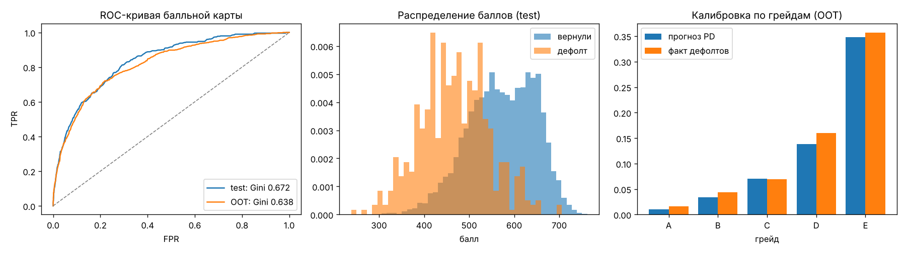

# Отчет о модели msb-scorecard 1.0.0

> Демо-модель на **синтетических** данных (`data/train.csv`, sha256: `68c19b26e250979a…`).
> Метрики показывают, что конвейер обучения и валидации работает, а не качество на реальных клиентах.

Обучена: 2026-10-20T17:35:46+00:00 · train: 15630 · test: 6699 · OOT: 7349

## 1. Назначение
Оценка вероятности дефолта (PD) заявки МСБ на горизонте 12 мес. для кредитной логики:
грейд риска → ставка, ручная проверка или отказ. Решение принимает не модель, а политика
(`decision.py`), модель — один из входов.

## 2. Подход
* Балльная карта: WoE-биннинг (дерево решений + слияние до монотонности WoE) →
  логистическая регрессия → шкала баллов (база 600 баллов при шансах
  50:1, удвоение шансов каждые 40 баллов).
* Отбор признаков: IV ≥ 0.02; признаки с коэффициентом «не того» знака исключаются.
* Челленджер: градиентный бустинг (HistGradientBoosting) на тех же признаках.

## 3. Качество
Gini = 2·AUC − 1 (различающая способность), KS, Brier (точность вероятностей).

| Выборка | n | default_rate | mean_pd | gini | ks | brier |
|---|---|---|---|---|---|---|
| train | 15630 | 0.0749 | 0.0751 | 0.6697 | 0.5237 | 0.0574 |
| test | 6699 | 0.0749 | 0.0734 | 0.6718 | 0.5203 | 0.0577 |
| OOT (с 2026-01-01) | 7349 | 0.0815 | 0.074 | 0.6379 | 0.5019 | 0.0624 |
| test — бустинг (челленджер) | 6699 | 0.0749 | 0.0726 | 0.6758 | 0.5227 | 0.0579 |
| OOT — бустинг (челленджер) | 7349 | 0.0815 | 0.0731 | 0.6494 | 0.5003 | 0.0622 |

**Стабильность.** PSI баллов train → OOT: **0.0029**
(< 0.1 — стабильно, 0.1–0.25 — наблюдать, > 0.25 — пересматривать модель).

PSI по признакам:

| feature | psi |
|---|---|
| business_age_months | 0.0009 |
| log_revenue | 0.0002 |
| net_margin | 0.0004 |
| revenue_trend | 0.001 |
| revenue_volatility | 0.0003 |
| debt_to_revenue | 0.0005 |
| dscr | 0.0009 |
| loan_to_revenue | 0.0005 |
| bki_max_overdue_days_12m | 0.0 |
| bki_inquiries_3m | 0.0004 |
| industry | 0.0016 |
| tax_arrears | 0.0 |

## 4. Калибровка по грейдам

Test:

| grade | count | predicted_pd | observed_dr | share |
|---|---|---|---|---|
| A | 2539 | 0.0103 | 0.011 | 0.379 |
| B | 1520 | 0.0334 | 0.027 | 0.2269 |
| C | 1219 | 0.0713 | 0.0861 | 0.182 |
| D | 799 | 0.1387 | 0.1314 | 0.1193 |
| E | 622 | 0.3491 | 0.3585 | 0.0928 |

OOT:

| grade | count | predicted_pd | observed_dr | share |
|---|---|---|---|---|
| A | 2828 | 0.0104 | 0.0159 | 0.3848 |
| B | 1683 | 0.0336 | 0.0434 | 0.229 |
| C | 1267 | 0.0704 | 0.0695 | 0.1724 |
| D | 850 | 0.1387 | 0.16 | 0.1157 |
| E | 721 | 0.3477 | 0.3564 | 0.0981 |

## 5. Отбор признаков (IV)

| feature | Признак | iv | selected | coef | reason_dropped |
|---|---|---|---|---|---|
| dscr | Покрытие платежей денежным потоком (DSCR) | 0.9987 | True | 0.8159 |  |
| net_margin | Рентабельность | 0.6228 | True | 0.3157 |  |
| bki_max_overdue_days_12m | Максимальная просрочка в БКИ | 0.4383 | True | 0.8708 |  |
| bki_overdue_count_12m | Количество просрочек в БКИ | 0.4155 | False |  | корреляция WoE с bki_max_overdue_days_12m > 0.8 |
| bki_inquiries_3m | Число запросов кредитной истории за 3 мес. | 0.1586 | True | 0.3283 |  |
| industry | Отрасль | 0.1385 | True | 0.3964 |  |
| business_age_months | Срок ведения бизнеса | 0.0991 | True | 1.0707 |  |
| loan_to_revenue | Размер запроса относительно выручки | 0.0686 | True | 0.1785 |  |
| log_revenue | Масштаб выручки | 0.0685 | True | 0.3148 |  |
| revenue_trend | Динамика выручки | 0.0662 | True | 1.1502 |  |
| tax_arrears | Налоговая задолженность | 0.0504 | True | 0.6745 |  |
| debt_to_revenue | Текущая долговая нагрузка | 0.0464 | True | 0.7819 |  |
| revenue_volatility | Стабильность оборотов | 0.045 | True | 1.1264 |  |
| director_changes_12m | Смены руководителя за 12 мес. | 0.0151 | False |  | IV=0.0151 < 0.02 |
| legal_form | Организационно-правовая форма | 0.0113 | False |  | IV=0.0113 < 0.02 |
| mass_address | Адрес массовой регистрации | 0.006 | False |  | IV=0.0060 < 0.02 |

## 6. Балльная карта (используемые признаки)

| feature | Признак | bin | count | bad_rate | woe | points |
|---|---|---|---|---|---|---|
| business_age_months | Срок ведения бизнеса | <= 23.5 | 4094 | 0.1016 | 0.334 | 23.0 |
| business_age_months | Срок ведения бизнеса | (23.5; 49.5] | 5308 | 0.0806 | 0.0797 | 38.0 |
| business_age_months | Срок ведения бизнеса | (49.5; 80.5] | 2987 | 0.0609 | -0.2202 | 57.0 |
| business_age_months | Срок ведения бизнеса | (80.5; 150.5] | 2308 | 0.049 | -0.4499 | 71.0 |
| business_age_months | Срок ведения бизнеса | > 150.5 | 933 | 0.0332 | -0.8428 | 95.0 |
| log_revenue | Масштаб выручки | <= 6.713 | 1587 | 0.1229 | 0.5491 | 33.0 |
| log_revenue | Масштаб выручки | (6.713; 6.843] | 904 | 0.1029 | 0.3515 | 37.0 |
| log_revenue | Масштаб выручки | (6.843; 7.113] | 2614 | 0.08 | 0.0716 | 42.0 |
| log_revenue | Масштаб выручки | (7.113; 7.188] | 930 | 0.0763 | 0.0258 | 43.0 |
| log_revenue | Масштаб выручки | > 7.188 | 9595 | 0.0627 | -0.1907 | 47.0 |
| net_margin | Рентабельность | <= -0.0375 | 481 | 0.3181 | 1.7512 | 11.0 |
| net_margin | Рентабельность | (-0.0375; 0.0015] | 1067 | 0.2109 | 1.194 | 22.0 |
| net_margin | Рентабельность | (0.0015; 0.0205] | 994 | 0.1278 | 0.5945 | 33.0 |
| net_margin | Рентабельность | (0.0205; 0.0495] | 2120 | 0.0887 | 0.1846 | 40.0 |
| net_margin | Рентабельность | (0.0495; 0.1265] | 6728 | 0.0534 | -0.3625 | 50.0 |
| net_margin | Рентабельность | > 0.1265 | 4240 | 0.0278 | -1.0373 | 62.0 |
| revenue_trend | Динамика выручки | <= -0.0895 | 2650 | 0.1079 | 0.4018 | 17.0 |
| revenue_trend | Динамика выручки | (-0.0895; 0.0595] | 4400 | 0.0791 | 0.059 | 39.0 |
| revenue_trend | Динамика выручки | (0.0595; 0.2095] | 4777 | 0.0682 | -0.1001 | 50.0 |
| revenue_trend | Динамика выручки | (0.2095; 0.3855] | 3080 | 0.0597 | -0.2412 | 59.0 |
| revenue_trend | Динамика выручки | > 0.3855 | 723 | 0.036 | -0.7579 | 94.0 |
| revenue_volatility | Стабильность оборотов | <= 0.0505 | 728 | 0.0508 | -0.4021 | 70.0 |
| revenue_volatility | Стабильность оборотов | (0.0505; 0.2475] | 7961 | 0.0663 | -0.1313 | 52.0 |
| revenue_volatility | Стабильность оборотов | (0.2475; 0.3945] | 3972 | 0.0788 | 0.0551 | 40.0 |
| revenue_volatility | Стабильность оборотов | (0.3945; 0.6095] | 2203 | 0.0867 | 0.1602 | 33.0 |
| revenue_volatility | Стабильность оборотов | > 0.6095 | 766 | 0.1319 | 0.6319 | 2.0 |
| debt_to_revenue | Текущая долговая нагрузка | <= 0.1479 | 10176 | 0.0678 | -0.1078 | 48.0 |
| debt_to_revenue | Текущая долговая нагрузка | (0.1479; 0.2393] | 2235 | 0.0711 | -0.054 | 46.0 |
| debt_to_revenue | Текущая долговая нагрузка | (0.2393; 0.414] | 2164 | 0.0846 | 0.133 | 37.0 |
| debt_to_revenue | Текущая долговая нагрузка | (0.414; 0.5441] | 621 | 0.1176 | 0.5025 | 21.0 |
| debt_to_revenue | Текущая долговая нагрузка | > 0.5441 | 434 | 0.1498 | 0.7823 | 8.0 |
| dscr | Покрытие платежей денежным потоком (DSCR) | <= -0.01738 | 642 | 0.3255 | 1.7849 | -41.0 |
| dscr | Покрытие платежей денежным потоком (DSCR) | (-0.01738; 0.4938] | 1478 | 0.182 | 1.0106 | -4.0 |
| dscr | Покрытие платежей денежным потоком (DSCR) | (0.4938; 0.9814] | 3498 | 0.1043 | 0.3634 | 26.0 |
| dscr | Покрытие платежей денежным потоком (DSCR) | (0.9814; 1.148] | 1773 | 0.0705 | -0.0633 | 46.0 |
| dscr | Покрытие платежей денежным потоком (DSCR) | (1.148; 1.429] | 2454 | 0.0456 | -0.524 | 68.0 |
| dscr | Покрытие платежей денежным потоком (DSCR) | > 1.429 | 5785 | 0.0156 | -1.6301 | 120.0 |
| loan_to_revenue | Размер запроса относительно выручки | <= 0.02109 | 1705 | 0.0346 | -0.8076 | 52.0 |
| loan_to_revenue | Размер запроса относительно выручки | (0.02109; 0.03969] | 3155 | 0.07 | -0.0711 | 44.0 |
| loan_to_revenue | Размер запроса относительно выручки | (0.03969; 0.4006] | 10361 | 0.0809 | 0.0829 | 43.0 |
| loan_to_revenue | Размер запроса относительно выручки | > 0.4006 | 409 | 0.1271 | 0.5945 | 37.0 |
| bki_max_overdue_days_12m | Максимальная просрочка в БКИ | <= 0.5 | 14091 | 0.0562 | -0.3071 | 59.0 |
| bki_max_overdue_days_12m | Максимальная просрочка в БКИ | (0.5; 30.5] | 1114 | 0.2047 | 1.1575 | -15.0 |
| bki_max_overdue_days_12m | Максимальная просрочка в БКИ | > 30.5 | 425 | 0.3529 | 1.9086 | -53.0 |
| bki_inquiries_3m | Число запросов кредитной истории за 3 мес. | <= 0.5 | 5314 | 0.0538 | -0.3527 | 50.0 |
| bki_inquiries_3m | Число запросов кредитной истории за 3 мес. | (0.5; 1.5] | 5425 | 0.0664 | -0.1303 | 46.0 |
| bki_inquiries_3m | Число запросов кредитной истории за 3 мес. | (1.5; 2.5] | 3069 | 0.0821 | 0.1002 | 41.0 |
| bki_inquiries_3m | Число запросов кредитной истории за 3 мес. | (2.5; 3.5] | 1203 | 0.1197 | 0.5201 | 34.0 |
| bki_inquiries_3m | Число запросов кредитной истории за 3 мес. | > 3.5 | 619 | 0.2068 | 1.1709 | 21.0 |
| industry | Отрасль | agro | 934 | 0.091 | 0.2151 | 38.0 |
| industry | Отрасль | construction | 1604 | 0.1091 | 0.4138 | 34.0 |
| industry | Отрасль | food | 1521 | 0.0736 | -0.0168 | 44.0 |
| industry | Отрасль | it | 1251 | 0.0296 | -0.9665 | 65.0 |
| industry | Отрасль | manufacturing | 1573 | 0.054 | -0.3458 | 51.0 |
| industry | Отрасль | services | 2790 | 0.0477 | -0.4798 | 54.0 |
| industry | Отрасль | trade | 4042 | 0.0881 | 0.1751 | 39.0 |
| industry | Отрасль | transport | 1915 | 0.0977 | 0.29 | 37.0 |
| tax_arrears | Налоговая задолженность | no | 14728 | 0.0704 | -0.0664 | 46.0 |
| tax_arrears | Налоговая задолженность | yes | 902 | 0.1475 | 0.762 | 14.0 |

## 7. Ограничения
* Данные синтетические: зависимости заданы генератором (`datagen.latent_risk`).
* В OOT заложен дрейф уровня риска: сравните прогноз и факт по грейдам выше. В
  реальном процессе это сигнал к перекалибровке.
* Ставки, лимиты и пороги политики — демо-значения (`config.py`).
